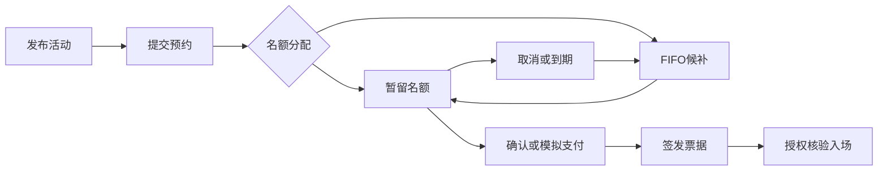

# EventFulfill

活动预约与票务履约平台，面向技术沙龙、校园活动和企业内部活动，提供活动发布、限额预约、候补递补、确认支付与入场核验的完整流程。

## 核心功能

- **活动与场次管理**：配置容量、费用和确认期限，发布活动，查看候补队列及履约摘要。
- **限额预约与有序候补**：异步处理预约，按 FIFO 分配候补名额，支持取消、到期释放和自动递补。
- **确认与票据履约**：免费确认、模拟支付、票据签发，以及授权核验员的一次性入场核验。
- **消息与运营管理**：站内通知、操作审计、消费失败记录及原事件重放。
- **角色权限**：主办方、参与者、核验员和运维角色，支持按场次授权核验。

## 技术栈

| 层次 | 技术 |
|---|---|
| 后端 | Java 17、Spring Boot、MyBatis-Plus |
| 数据与缓存 | MySQL、Redis、Lua、Redisson |
| 异步处理 | RocketMQ、事务 Outbox、XXL-JOB |
| 页面 | Vue 3 |
| 工程工具 | Maven、JUnit、Docker Compose、k6 |
| 服务治理与观测 | Spring Cloud Gateway、Nacos、Resilience4j、OpenTelemetry、Prometheus、Grafana |

## 业务流程



场次行锁、条件更新和唯一约束维护容量与预约状态。业务变更与 Outbox 在同一事务提交，消息消费通过收据实现幂等；Redis 承担展示缓存、热点访问和请求准入，后台任务处理到期与补偿。

## 快速开始

准备 PowerShell 7、JDK 17+、Maven、Node.js 和 Docker Desktop。

```powershell
./scripts/init-local.ps1
./scripts/verify.ps1
./scripts/apps-build.ps1
./scripts/apps-start.ps1
```

访问 **http://127.0.0.1:8090/**。接口文档位于 `/swagger-ui/index.html`。

本地账号：`organizer`（主办方）、`alice` / `bob`（参与者）、`checker`（核验员）、`operator`（运维）。初始化脚本生成的登录密码位于 `infra/.env` 的 `EVENT_DEMO_PASSWORD`。

停止服务：

```powershell
./scripts/apps-stop.ps1
```

## 项目结构

```text
event-platform/          Java业务、页面与测试
event-platform/gateway/  API网关
event-platform/load/     k6场景
infra/                   中间件与部署配置
scripts/                 初始化、构建、验证与运行入口
tools/probes/            诊断和流程验证工具
docs/                    部署、验证与组件说明
```

## 文档

- [部署与配置](docs/INTEGRATION.md)
- [验证记录](docs/VERIFICATION.md)
- [第三方组件与许可](docs/THIRD_PARTY_NOTICES.md)
